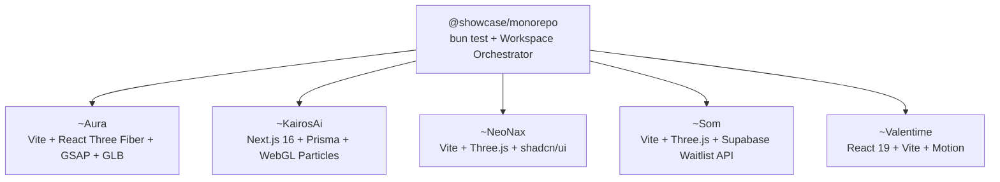

# Web Experience Showcase — Multi-Project Portfolio

Welcome to the **Web Experience Showcase**, a curated collection of five premium, production-ready web applications demonstrating state-of-the-art interactive front-ends, advanced layouts, immersive 3D/WebGL experiences, and highly responsive user interfaces. 

This showcase bundle demonstrates production architectures spanning luxury 3D e-commerce (**~Aura**), autonomous AI platform UX (**~KairosAi**), WebGL material engineering (**~NeoNax**), beverage launch waitlists (**~Som**), and interactive storytelling (**~Valentime**).



---

## 📂 Featured Applications

| Project | Directory | Description | Key Tech Stack | Features |
| :--- | :--- | :--- | :--- | :--- |
| **Aura** | [`~Aura`](./~Aura) | Ultra-premium 3D cosmetics & makeup landing page with luxury aesthetics. | React, Vite, Three.js, GSAP, Tailwind CSS | Interactive 3D product models, custom cursor, scroll parallax, magnetic elements. |
| **Kairos AI** | [`~KairosAi`](./~KairosAi) | Clean, futuristic landing page for an autonomous AI agent deployment platform. | Next.js 16+, React 19, Three.js, Framer Motion, Prisma | Aurora gradients, interactive particle fields, smooth scroll, responsive dynamic routing. |
| **NeoNax** | [`~NeoNax`](./~NeoNax) | Interactive futuristic laboratory/materials 3D product showcase. | React, Vite, Three.js, Tailwind CSS, Lucide | 3D can/fluid visualization, micro-animations, customizable responsive components. |
| **Som** | [`~Som`](./~Som) | Interactive beverage product landing page showcasing premium packaging. | React, Vite, Three.js, Tailwind CSS | Interactive 3D liquid/can models, real-time waitlist database integration, preloader. |
| **Valentime** | [`~Valentime`](./~Valentime) | Interactive "Be My Valentine" proposal experience with dynamic date planner. | React 19, Vite, Motion, Tailwind CSS v4 | Interactive proposal flow, date planner, cute responsive micro-animations. |

---

## 🚀 Getting Started

### Prerequisites

Ensure you have the following installed on your local environment:
- **Node.js** (v18.0.0 or higher recommended)
- **npm** (v9.0.0+), **Yarn**, or **Bun**

### Monorepo & Workspaces

The root repository provides unified workspace management and automated smoke test validation:

```bash
# Run automated showcase verification across all 5 projects
bun test

# Or inspect individual showcase applications:
cd ~Aura    # Or any of the 5 project folders
bun install
bun run dev
```

### Production Build

```bash
cd ~Aura    # Or ~KairosAi, ~NeoNax, etc.
bun run build
```

This generates an optimized static bundle in the project's `dist` or `.next` folder.

---

## 🛠️ Global Technology Stack

Across the five websites, the codebase implements:
- **Frameworks:** [React](https://react.dev/), [Next.js](https://nextjs.org/) (App Router)
- **Styling:** Vanilla CSS, [Tailwind CSS](https://tailwindcss.com/)
- **Animation & 3D:** [Three.js](https://threejs.org/), [@react-three/fiber](https://r3.docs.pmnd.rs/getting-started/introduction), [GSAP](https://gsap.com/), [Framer Motion](https://www.framer.com/motion/)
- **Utility Libraries:** [Lenis](https://lenis.darkroom.engineering/) (Smooth Scroll), [Lucide React](https://lucide.dev/), [Zustand](https://zustand-demo.pmnd.rs/) (State Management)

---

## 📄 Commercial Licensing & IP Acquisition

Copyright (c) 2026 Kushal (@onlykushalll). All Rights Reserved.  
All code and digital assets within this repository are proprietary and licensed under the [Proprietary Commercial Source & Evaluation License](./LICENSE.md).

Available for commercial licensing, technical due diligence, and full IP acquisition.  
**Acquisition & Licensing Contact:** `creatormanager27@gmail.com` · GitHub: `https://github.com/onlykushalll`

### Third-Party Open-Source Carve-Out
Upstream frameworks and runtime dependencies (React, Next.js, Vite, Three.js, React Three Fiber, Framer Motion, Tailwind CSS, Prisma, GSAP under its standard license) remain governed by their respective upstream terms. See [docs/ARCHITECTURE.md](./docs/ARCHITECTURE.md) for monorepo engineering details.
